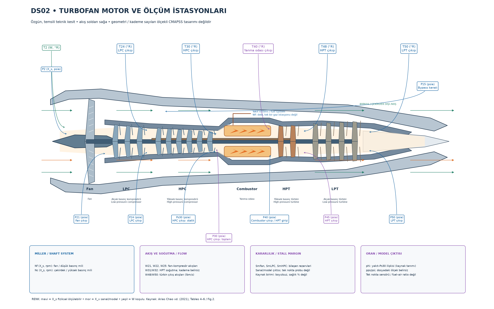
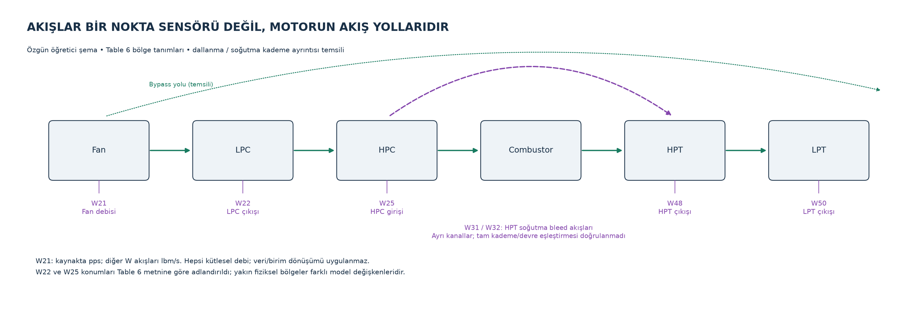

# DS02 Motor ve Sensör Atlası

Bu atlas, değişken ezberlemek yerine **akış yolu → bileşenin işi → ölçülen büyüklük → koşul etkisi → yorum sınırı** zincirini öğretir. [47 değişkenli veri sözlüğü](DS02_Degisken_Sozlugu.md) ad/birim başvurusudur; bu belge konum ve fiziksel yorum rehberidir.

## 1. Kaynak ve çizimin niteliği

Esas kaynak: [Arias Chao vd. (2021), Aircraft Engine Run-to-Failure Dataset under Real Flight Conditions for Prognostics and Diagnostics](https://doi.org/10.3390/data6010005), özellikle Figure 2, Tables 4–8 ve Sections 2.1/3.1–3.2. [Yayıncı PDF](https://mdpi-res.com/d_attachment/data/data-06-00005/article_deploy/data-06-00005-v2.pdf?version=1611240730). Temel turbofan işleyişi için [NASA Glenn turbofan](https://www.grc.nasa.gov/www/k-12/airplane/Animation/turbtyp/etfp.html) ve [gaz türbini rehberi](https://www1.grc.nasa.gov/beginners-guide-to-aeronautics/turbine-engines/) kullanılmıştır.

Aşağıdaki iki çizim proje için **özgün geometrik/vector çizim olarak üretilmiştir**; başka bir motor fotoğrafı veya makale figürü kopyalanmamıştır. Makalenin CC BY 4.0 teknik tanımları kaynak gösterilerek Türkçe yorumlanır. Çizimlerin geometri, rotor/stator kanat sayısı, kesit oranları, mil çapları ve ince soğutma devreleri **temsili ve ölçeksizdir**. CMAPSS'in gerçek CAD'i veya birebir prob yerleşimi değildir. Bölge/istasyon anlamları kaynakla kontrol edilmiştir; milimetre düzeyinde ölçüm noktası iddiası yoktur.

## 2. Açıklamalı kesit — hava soldan sağa

[Büyütülebilir SVG kesiti](assets/ds02_turbofan_kesit.svg). PNG hızlı görüntüleme, SVG yakınlaştırma ve sunum için uygundur. **Mavi X_s fiziksel ölçülebilir, mor X_v sanal/model, yeşil W çalışma koşulu** anlamındadır. İnce ölçüm okları bir bölgeyi işaret eder; akış oklarıysa soldan sağadır. Aynı bölgedeki Ps30 ve P30 farklı ölçüm türleridir; renklere ek olarak ad/etiket de ayrımı taşır.

### İşlem zinciri

| Bölüm | Türkçe / İngilizce | Akışa ne yapar? | İlişkili sinyaller |
|---|---|---|---|
| Fan | Fan / fan | Giriş havasını hızlandırır; çekirdek ve bypass yollarını besler. | T2/P2 giriş, P21 çıkış, P15 bypass, Nf, W21, SmFan |
| LPC | Alçak basınç kompresörü / low-pressure compressor | Çekirdek havasının ilk sıkıştırma bölümüdür. | T24/P24, W22, SmLPC |
| HPC | Yüksek basınç kompresörü / high-pressure compressor | Yanma öncesi sıkıştırmayı yükseltir. | T30/Ps30/P30, W25, Nc, SmHPC |
| Combustor | Yanma odası / combustion chamber, burner | Yakıtla ısı eklenir; akışın enerjisi artar. | Wf yakıt sistemi, T40/P40 çıkış |
| HPT | Yüksek basınç türbini / high-pressure turbine | Sıcak gazdan iş çekerek HPC/çekirdek milini sürer. | T48/P45 çıkış, W31/W32 soğutma, W48 |
| LPT | Alçak basınç türbini / low-pressure turbine | Kalan enerjiden iş çekerek fan/LPC tarafını sürer. | T50/P50, W50; düşük basınç miliyle Nf ilişkisi |

Basınç/sıcaklık sıkıştırma, yanma ve türbin işiyle değişir. Ancak aynı anda irtifa, hız, komut ve giriş sıcaklığı da değişebilir: bir sinyalin artışı doğrudan arıza demek değildir. **Total** ve **static** farklı termodinamik tanımlardır; adlardaki sayılar zaman veya sensör sıra numarası değildir.

### İstasyon eşleştirmesi ve güven düzeyi

| Değişkenler | Kaynak tanımı | Konumun doğrulanma sınırı |
|---|---|---|
| T2 / P2 | Fan girişindeki toplam sıcaklık / basınç | Tables 4–5 ile bölge doğrulanır. T2 W koşulu, P2 X_s'dir. Geometrik ok temsili. |
| P15 | Bypass kanalı toplam basıncı | Table 5; çekirdeğin HPC istasyonu değildir. |
| P21 | Fan çıkışı toplam basıncı | Table 5; yalnızca çizimsel bölge bağlantısı. |
| T24 / P24 | LPC çıkışı toplam sıcaklık / basınç | Table 5; istasyon adı korunur. |
| T30 / Ps30 / P30 | HPC çıkışı; sıcaklık toplam, Ps30 statik, P30 toplam basınç | Tables 5–6. Ps30 ile P30 eşit değildir; iki basıncın biri fiziksel ölçülebilir diğeri sanaldır. |
| T40 / P40 | Yanma odası çıkışı toplam sıcaklık / basınç | Tables 5–6; akış yolu üzerinde HPT giriş bölgesidir. T40 X_v, P40 X_s'dir. |
| T48 / P45 | HPT çıkışı toplam sıcaklık / basınç | Tables 5–6. Sıcaklık ve basıncın farklı numaraları kaynağın verdiği adlardır; bunları eşitlemedik. |
| T50 / P50 | LPT çıkışı toplam sıcaklık / basınç | Table 5; kesin prob mesafesi/kademe yeri doğrulanmış değildir. |

## 3. Akışlar ve sistem değişkenleri — tek nokta probu değiller

[Büyütülebilir SVG akış şeması](assets/ds02_akis_sistemleri.svg). Kesikli soğutma bağlantısı yalnızca genel ilişkiyi anlatır; W31/W32'nin devre ve kademe ayrımı doğrulanmamıştır. Bypass çizgisi çekirdeği dolaşan ayrı yolu temsil eder; LPT'ye akış girişi değildir.

- **W21:** fan kütlesel debisi (kaynakta pps). Fan toplam akışı ile çekirdekteki akışın aynı büyüklükte olması gerekmez.
- **W22:** Table 6'ya göre LPC çıkış debisi; başka istasyon belgesi görülmeden isimden farklı bir konum uydurulmaz.
- **W25:** HPC giriş debisi. W22 ile yakın değerler taşıması aynı değişken oldukları anlamına gelmez.
- **W31/W32:** ikisi de kaynakta HPT soğutma bleed debisi olarak geçer. Soğutma ihtiyacı ve akış paylaşımıyla ilişkili ayrı model kanallarıdır; rotor/stator/kademe ataması yapılmaz.
- **W48/W50:** HPT/LPT çıkışındaki gaz akışları. Yakıt eklenmesi, bleed/soğutma ve farklı kontrol koşulları nedeniyle giriş hava debilerinin basit kopyası sayılmaz.
- **Nf/Nc:** fan/düşük basınç ve çekirdek/yüksek basınç mili sistemlerinin hızları; gaz akışının tek bir sıcaklık/basınç istasyonunda duran sensör noktaları gibi çizilmez.
- **Wf:** yanma odasını besleyen yakıt sistemi debisidir; hava debisi veya yakıt/hava oranı değildir.
- **SmFan/SmLPC/SmHPC:** ilgili bileşenin model kararlılık marjıdır; bir basınç probu veya sağlık yüzdesi değildir.
- **phi:** makale tanımında yakıt debisinin Ps30'a oranıyla ilişkilidir; dosyanın ölçeği belirsizdir. Ayrı bir fiziksel prob veya boyutsuz eşdeğerlik oranı gibi konumlandırılmaz.

## 4. Birim ve grafik okuma notları

- Sıcaklık **°R**, Celsius değil; basınç **psia**, gösterge basıncı değil; dönüş hızı **rpm**.
- pps ve lbm/s kütlesel debi gösterimleridir; grafikte **lbm/s** ortak etiketi kullanılır. Sayısal değerler dönüştürülmemiştir. lb/s ifadesinin kütle mi kuvvet mi olduğu belirsiz kalmasın diye lbm açıkça yazılır.
- **TRA için makale Table 4 % verir**; açı kelimesine veya örnek etikete bakıp ° eklenmez. Mach boyutsuzdur; T2 °R'dir.
- Stall marjları Table 6'da **—** ile verilir; yüzde verim/sağlık etiketi eklenmez.
- phi küçük panellerde **pps/psi***; yıldız **kaynak birimi korunuyor, dosya ölçeği doğrulanmadı** demektir. Büyük etiket ve seçim açıklaması bu belirsizliği açık yazar. [Sözlükte phi kontrolü](DS02_Degisken_Sozlugu.md#birimler).
- sample_index **uçuş içindeki ölçüm sırası, saniye değil**; cycle **uçuş döngüsü**; RUL **kalan uçuş döngüsü**.
- Normalize yaşam ilerlemesi **0–1, boyutsuz, yalnızca görsel karşılaştırma**dır; yaşam sonu bilgisi kullandığından tahmin girdisi gibi yorumlanmaz.
- Medyan çizgisi uçuşun merkezî eğilimini; Q1–Q3 bandı uçuş içi dağılımı gösterir. Bant güven aralığı değildir. Sağlık grafiklerindeki min–maksimum bandı ile karıştırmayın.

## 5. Sensörleri neden/sonuç ezberlemeden incelemek

Aşağıdaki artış/azalış yorumları **araştırılabilecek olasılıklar**dır; veri üzerinde doğrulanmış arıza teşhisleri değildir. Karşılaştırmada alt/Mach/TRA/T2, diğer kanallar, referans motor, kontrol sistemi ve uçuş fazı dikkate alınmalıdır. Birimin aynı olması konumun veya fiziksel anlamın aynı olduğu anlamına gelmez. Fiziksel ölçülebilir X_s de bu veri setinde simüle motor yanıtıdır; X_v iç model çıktısıdır.

### 14 fiziksel ölçülebilir sensör

#### T24 — LPC çıkış toplam sıcaklığı

- **İngilizce:** Low-pressure-compressor discharge total temperature.
- **Birim:** °R. **Bölge/sistem:** LPC çıkışı.
- **Neyi temsil eder?** Sıkıştırma sonrası termal durum. T2 ve koşullarla birlikte okunur; tek başına verim hesabı değildir.
- **Artışta araştırılabilecekler:** Giriş sıcaklığı, sıkıştırma oranı, yük veya karşılaştırılabilir koşullarda kompresörün termodinamik davranışı araştırılır.
- **Azalışta araştırılabilecekler:** Daha soğuk giriş, düşük güç/sıkıştırma talebi ve çalışma noktası değişimi araştırılır; doğrudan iyileşme denmez.
- **Neden tek başına kanıt değil?** Sıcaklık koşul ve kontrol etkilerini içerir; aynı çalışma noktası, ilgili diğer istasyonlar ve referans olmadan bozulma/arıza kanıtı değildir.

#### T30 — HPC çıkış toplam sıcaklığı

- **İngilizce:** High-pressure-compressor discharge total temperature.
- **Birim:** °R. **Bölge/sistem:** HPC çıkışı.
- **Neyi temsil eder?** Yanma öncesi sıkıştırılmış havanın sıcaklığı. Yük ve sıkıştırma durumundan etkilenir.
- **Artışta araştırılabilecekler:** Giriş sıcaklığı, sıkıştırma oranı, yük veya karşılaştırılabilir koşullarda kompresörün termodinamik davranışı araştırılır.
- **Azalışta araştırılabilecekler:** Daha soğuk giriş, düşük güç/sıkıştırma talebi ve çalışma noktası değişimi araştırılır; doğrudan iyileşme denmez.
- **Neden tek başına kanıt değil?** Sıcaklık koşul ve kontrol etkilerini içerir; aynı çalışma noktası, ilgili diğer istasyonlar ve referans olmadan bozulma/arıza kanıtı değildir.

#### T48 — HPT çıkış toplam sıcaklığı

- **İngilizce:** High-pressure-turbine discharge total temperature.
- **Birim:** °R. **Bölge/sistem:** HPT çıkışı.
- **Neyi temsil eder?** Türbinde enerji çekilmesi sonrası termal durum. HI tanımında referans koşullardaki T48 kullanılır; ham T48 doğrudan HI değildir.
- **Artışta araştırılabilecekler:** Yanma tarafındaki ısı girdisi, yük, hava akışı ve türbinde çekilen işin birlikte değişimi araştırılır.
- **Azalışta araştırılabilecekler:** Daha düşük ısı girdisi/yük, değişen akış koşulları veya türbin işi paylaşımı araştırılır; tek başına daha iyi verim denmez.
- **Neden tek başına kanıt değil?** Sıcaklık koşul ve kontrol etkilerini içerir; aynı çalışma noktası, ilgili diğer istasyonlar ve referans olmadan bozulma/arıza kanıtı değildir.

#### T50 — LPT çıkış toplam sıcaklığı

- **İngilizce:** Low-pressure-turbine discharge total temperature.
- **Birim:** °R. **Bölge/sistem:** LPT çıkışı.
- **Neyi temsil eder?** Türbin zinciri sonundaki termal durum; T48 ile farklı konumdadır.
- **Artışta araştırılabilecekler:** Yanma tarafındaki ısı girdisi, yük, hava akışı ve türbinde çekilen işin birlikte değişimi araştırılır.
- **Azalışta araştırılabilecekler:** Daha düşük ısı girdisi/yük, değişen akış koşulları veya türbin işi paylaşımı araştırılır; tek başına daha iyi verim denmez.
- **Neden tek başına kanıt değil?** Sıcaklık koşul ve kontrol etkilerini içerir; aynı çalışma noktası, ilgili diğer istasyonlar ve referans olmadan bozulma/arıza kanıtı değildir.

#### P15 — Bypass kanalı toplam basıncı

- **İngilizce:** Bypass-duct total pressure.
- **Birim:** psia. **Bölge/sistem:** Fan bypass kanalı.
- **Neyi temsil eder?** Çekirdeği dolaşan akışın basıncı; HPC basıncıyla aynı yer değildir.
- **Artışta araştırılabilecekler:** Giriş mutlak basıncı, kompresör hızı/basınç oranı, güç talebi ve bölgesel akış değişimi araştırılır.
- **Azalışta araştırılabilecekler:** Yükselen irtifa, düşen güç talebi, bölgesel basınç kayıpları ve çalışma noktası araştırılır; otomatik kaçak teşhisi konmaz.
- **Neden tek başına kanıt değil?** Basınç ortam ve motor çalışma noktasından güçlü biçimde etkilenir. Total/statik ayrımı ve diğer istasyonlar olmadan tek değer bileşen sağlığını belirlemez.

#### P2 — Fan giriş toplam basıncı

- **İngilizce:** Fan-inlet total pressure.
- **Birim:** psia. **Bölge/sistem:** Fan girişi.
- **Neyi temsil eder?** İrtifa/Mach etkisini taşır; mutlak toplam basınçtır, gösterge basıncı değil.
- **Artışta araştırılabilecekler:** Giriş mutlak basıncı, kompresör hızı/basınç oranı, güç talebi ve bölgesel akış değişimi araştırılır.
- **Azalışta araştırılabilecekler:** Yükselen irtifa, düşen güç talebi, bölgesel basınç kayıpları ve çalışma noktası araştırılır; otomatik kaçak teşhisi konmaz.
- **Neden tek başına kanıt değil?** Basınç ortam ve motor çalışma noktasından güçlü biçimde etkilenir. Total/statik ayrımı ve diğer istasyonlar olmadan tek değer bileşen sağlığını belirlemez.

#### P21 — Fan çıkış toplam basıncı

- **İngilizce:** Fan-discharge total pressure.
- **Birim:** psia. **Bölge/sistem:** Fan çıkışı.
- **Neyi temsil eder?** Fan sonrası akış durumu. P2 ile birlikte incelenebilir; kendisi hesaplanmış basınç oranı değildir.
- **Artışta araştırılabilecekler:** Giriş mutlak basıncı, kompresör hızı/basınç oranı, güç talebi ve bölgesel akış değişimi araştırılır.
- **Azalışta araştırılabilecekler:** Yükselen irtifa, düşen güç talebi, bölgesel basınç kayıpları ve çalışma noktası araştırılır; otomatik kaçak teşhisi konmaz.
- **Neden tek başına kanıt değil?** Basınç ortam ve motor çalışma noktasından güçlü biçimde etkilenir. Total/statik ayrımı ve diğer istasyonlar olmadan tek değer bileşen sağlığını belirlemez.

#### P24 — LPC çıkış toplam basıncı

- **İngilizce:** Low-pressure-compressor discharge total pressure.
- **Birim:** psia. **Bölge/sistem:** LPC çıkışı.
- **Neyi temsil eder?** T24 ile aynı bileşen çıkışının farklı fiziksel büyüklüğünü betimler.
- **Artışta araştırılabilecekler:** Giriş mutlak basıncı, kompresör hızı/basınç oranı, güç talebi ve bölgesel akış değişimi araştırılır.
- **Azalışta araştırılabilecekler:** Yükselen irtifa, düşen güç talebi, bölgesel basınç kayıpları ve çalışma noktası araştırılır; otomatik kaçak teşhisi konmaz.
- **Neden tek başına kanıt değil?** Basınç ortam ve motor çalışma noktasından güçlü biçimde etkilenir. Total/statik ayrımı ve diğer istasyonlar olmadan tek değer bileşen sağlığını belirlemez.

#### Ps30 — HPC çıkış statik basıncı

- **İngilizce:** High-pressure-compressor discharge static pressure.
- **Birim:** psia. **Bölge/sistem:** HPC çıkışı.
- **Neyi temsil eder?** Yerel statik mutlak basınç. Sanal P30 toplam basınçtır; birbirinin yerine kullanılmaz.
- **Artışta araştırılabilecekler:** Giriş mutlak basıncı, kompresör hızı/basınç oranı, güç talebi ve bölgesel akış değişimi araştırılır. Statik basınç için hız/akış alanı değişimi de önemlidir.
- **Azalışta araştırılabilecekler:** Yükselen irtifa, düşen güç talebi, bölgesel basınç kayıpları ve çalışma noktası araştırılır; otomatik kaçak teşhisi konmaz.
- **Neden tek başına kanıt değil?** Basınç ortam ve motor çalışma noktasından güçlü biçimde etkilenir. Total/statik ayrımı ve diğer istasyonlar olmadan tek değer bileşen sağlığını belirlemez.

#### P40 — Yanma odası çıkışı / HPT girişi toplam basıncı

- **İngilizce:** Combustor-discharge total pressure.
- **Birim:** psia. **Bölge/sistem:** Combustor çıkışı / HPT girişi.
- **Neyi temsil eder?** Yanma sonrası basınç durumu. Yanma sıcaklığı artırsa da basınç mutlaka artmaz.
- **Artışta araştırılabilecekler:** Giriş mutlak basıncı, kompresör hızı/basınç oranı, güç talebi ve bölgesel akış değişimi araştırılır.
- **Azalışta araştırılabilecekler:** Yükselen irtifa, düşen güç talebi, bölgesel basınç kayıpları ve çalışma noktası araştırılır; otomatik kaçak teşhisi konmaz.
- **Neden tek başına kanıt değil?** Basınç ortam ve motor çalışma noktasından güçlü biçimde etkilenir. Total/statik ayrımı ve diğer istasyonlar olmadan tek değer bileşen sağlığını belirlemez.

#### P50 — LPT çıkış toplam basıncı

- **İngilizce:** Low-pressure-turbine discharge total pressure.
- **Birim:** psia. **Bölge/sistem:** LPT çıkışı.
- **Neyi temsil eder?** Türbin sonrası basınç; çıkış akışı ve ortam koşullarıyla birlikte yorumlanır.
- **Artışta araştırılabilecekler:** Giriş mutlak basıncı, kompresör hızı/basınç oranı, güç talebi ve bölgesel akış değişimi araştırılır.
- **Azalışta araştırılabilecekler:** Yükselen irtifa, düşen güç talebi, bölgesel basınç kayıpları ve çalışma noktası araştırılır; otomatik kaçak teşhisi konmaz.
- **Neden tek başına kanıt değil?** Basınç ortam ve motor çalışma noktasından güçlü biçimde etkilenir. Total/statik ayrımı ve diğer istasyonlar olmadan tek değer bileşen sağlığını belirlemez.

#### Nf — Fanın fiziksel dönüş hızı

- **İngilizce:** Physical fan rotational speed.
- **Birim:** rpm. **Bölge/sistem:** Fan / düşük basınç mili.
- **Neyi temsil eder?** Fiziksel mil hızı; sıcaklıkla düzeltilmiş hız olduğu varsayılmaz. Güç talebine bağlıdır.
- **Artışta araştırılabilecekler:** Güç komutu, kontrol hız hedefi, yük ve mil sisteminin diğer kanallarla birlikte yanıtı araştırılır. Daha yüksek rpm sağlıklı motor sıralaması değildir.
- **Azalışta araştırılabilecekler:** Düşük güç talebi, kontrol hedefi veya değişen giriş koşulları araştırılır; performans kaybı yalnızca olasılıklardan biridir.
- **Neden tek başına kanıt değil?** Hız kapalı çevrim kontrolle belirlenir; karşılaştırılabilir koşullar ve ilgili milin yükü bilinmeden arıza sonucu çıkarılmaz.

#### Nc — Çekirdeğin fiziksel dönüş hızı

- **İngilizce:** Physical core rotational speed.
- **Birim:** rpm. **Bölge/sistem:** Yüksek basınç / çekirdek mili.
- **Neyi temsil eder?** Nf ile aynı mil değildir; iki hızın ölçekleri farklı olabilir.
- **Artışta araştırılabilecekler:** Güç komutu, kontrol hız hedefi, yük ve mil sisteminin diğer kanallarla birlikte yanıtı araştırılır. Daha yüksek rpm sağlıklı motor sıralaması değildir.
- **Azalışta araştırılabilecekler:** Düşük güç talebi, kontrol hedefi veya değişen giriş koşulları araştırılır; performans kaybı yalnızca olasılıklardan biridir.
- **Neden tek başına kanıt değil?** Hız kapalı çevrim kontrolle belirlenir; karşılaştırılabilir koşullar ve ilgili milin yükü bilinmeden arıza sonucu çıkarılmaz.

#### Wf — Yakıt kütlesel debisi

- **İngilizce:** Fuel mass-flow rate.
- **Birim:** lbm/s. **Bölge/sistem:** Yakıt beslemesi / combustor.
- **Neyi temsil eder?** Birim zamanda verilen yakıt kütlesi. Hava debisi veya yakıt/hava oranı değildir; yük/komut etkisi içerir.
- **Artışta araştırılabilecekler:** Güç/itki talebinin yükselmesi, daha yüksek hava akışı veya aynı koşullardaki yakıt ihtiyacı değişimi araştırılır.
- **Azalışta araştırılabilecekler:** Düşük güç talebi, farklı uçuş fazı ve kontrolün yakıt komutu araştırılır. Daha düşük debi otomatik daha iyi verim değildir.
- **Neden tek başına kanıt değil?** Yakıtın hangi güç üretimi için kullanıldığı ve çalışma koşulları bilinmeden verim kaybı yüzdesi veya arıza belirlenemez.
- **Kaynak/konvansiyon notu:** Kaynakta pps veya lbm/s; pps pound-mass per second olarak kullanılır.

### 14 sanal/model sensörü

#### T40 — Yanma odası çıkış toplam sıcaklığı

- **İngilizce:** Combustor-discharge total temperature.
- **Birim:** °R. **Bölge/sistem:** Combustor çıkışı / HPT girişi.
- **Neyi temsil eder?** İç model sıcaklık çıktısı. T48 sonraki HPT çıkışıdır; aynı yer değildir.
- **Artışta araştırılabilecekler:** Yakıt/ısı girdisi, hava akışı, yük ve yanma bölgesinin kontrol durumu araştırılır; doğrulanmamış yakıt/hava oranı hesabı yapılmaz.
- **Azalışta araştırılabilecekler:** Azalan güç talebi, yakıt komutu veya farklı giriş/akış koşulları araştırılır.
- **Neden tek başına kanıt değil?** Sıcaklık koşul ve kontrol etkilerini içerir; aynı çalışma noktası, ilgili diğer istasyonlar ve referans olmadan bozulma/arıza kanıtı değildir.

#### P30 — HPC çıkış toplam basıncı

- **İngilizce:** High-pressure-compressor discharge total pressure.
- **Birim:** psia. **Bölge/sistem:** HPC çıkışı.
- **Neyi temsil eder?** Sanal toplam basınç. Fiziksel Ps30 statik basınçtır; eşit varsayılmaz.
- **Artışta araştırılabilecekler:** Giriş mutlak basıncı, kompresör hızı/basınç oranı, güç talebi ve bölgesel akış değişimi araştırılır.
- **Azalışta araştırılabilecekler:** Yükselen irtifa, düşen güç talebi, bölgesel basınç kayıpları ve çalışma noktası araştırılır; otomatik kaçak teşhisi konmaz.
- **Neden tek başına kanıt değil?** Basınç ortam ve motor çalışma noktasından güçlü biçimde etkilenir. Total/statik ayrımı ve diğer istasyonlar olmadan tek değer bileşen sağlığını belirlemez.

#### P45 — HPT çıkış toplam basıncı

- **İngilizce:** High-pressure-turbine discharge total pressure.
- **Birim:** psia. **Bölge/sistem:** HPT çıkışı.
- **Neyi temsil eder?** Table 6'nın verdiği konum. T48 ile istasyon numarasının aynı olması gerekmez; isimden yeni konum türetilmez.
- **Artışta araştırılabilecekler:** Giriş mutlak basıncı, kompresör hızı/basınç oranı, güç talebi ve bölgesel akış değişimi araştırılır.
- **Azalışta araştırılabilecekler:** Yükselen irtifa, düşen güç talebi, bölgesel basınç kayıpları ve çalışma noktası araştırılır; otomatik kaçak teşhisi konmaz.
- **Neden tek başına kanıt değil?** Basınç ortam ve motor çalışma noktasından güçlü biçimde etkilenir. Total/statik ayrımı ve diğer istasyonlar olmadan tek değer bileşen sağlığını belirlemez.

#### W21 — Fan kütlesel debisi

- **İngilizce:** Fan mass-flow rate.
- **Birim:** lbm/s. **Bölge/sistem:** Fan.
- **Neyi temsil eder?** Fan akışının model çıktısı. Çekirdek debileriyle aynı büyüklükte olmak zorunda değildir.
- **Artışta araştırılabilecekler:** Giriş yoğunluğu, mil hızı, güç talebi ve akış/bleed yollarının değişimi araştırılır. Bölgeye göre yakıt/soğutma katkıları da incelenir.
- **Azalışta araştırılabilecekler:** Düşük yük, farklı irtifa/sıcaklık, akış paylaşımı veya kapasite değişimi araştırılır; yalnızca akış miktarı teşhis değildir.
- **Neden tek başına kanıt değil?** Kütlesel debi çalışma koşullarına ve kontrol durumuna bağlıdır; farklı bölgeler/koşullar karşılaştırılmadan bileşen arızası göstermez.
- **Kaynak/konvansiyon notu:** Kaynakta pps veya lbm/s; pps pound-mass per second olarak kullanılır.

#### W22 — LPC çıkış kütlesel debisi

- **İngilizce:** Low-pressure-compressor outlet mass-flow rate.
- **Birim:** lbm/s. **Bölge/sistem:** LPC çıkışı (Table 6).
- **Neyi temsil eder?** Basılı kaynak açıklaması esas alınır. W25 ile ilişkili olsa da aynı kolon değildir; istasyon adından farklı konum varsaymayın.
- **Artışta araştırılabilecekler:** Giriş yoğunluğu, mil hızı, güç talebi ve akış/bleed yollarının değişimi araştırılır. Bölgeye göre yakıt/soğutma katkıları da incelenir.
- **Azalışta araştırılabilecekler:** Düşük yük, farklı irtifa/sıcaklık, akış paylaşımı veya kapasite değişimi araştırılır; yalnızca akış miktarı teşhis değildir.
- **Neden tek başına kanıt değil?** Kütlesel debi çalışma koşullarına ve kontrol durumuna bağlıdır; farklı bölgeler/koşullar karşılaştırılmadan bileşen arızası göstermez.
- **Kaynak/konvansiyon notu:** Kaynakta pps veya lbm/s; pps pound-mass per second olarak kullanılır.

#### W25 — HPC giriş kütlesel debisi

- **İngilizce:** High-pressure-compressor inlet mass-flow rate.
- **Birim:** lbm/s. **Bölge/sistem:** HPC girişi.
- **Neyi temsil eder?** Kompresöre giren model akışı. Bleed/akış yolları nedeniyle diğer debilerle eşit varsayılmaz.
- **Artışta araştırılabilecekler:** Giriş yoğunluğu, mil hızı, güç talebi ve akış/bleed yollarının değişimi araştırılır. Bölgeye göre yakıt/soğutma katkıları da incelenir.
- **Azalışta araştırılabilecekler:** Düşük yük, farklı irtifa/sıcaklık, akış paylaşımı veya kapasite değişimi araştırılır; yalnızca akış miktarı teşhis değildir.
- **Neden tek başına kanıt değil?** Kütlesel debi çalışma koşullarına ve kontrol durumuna bağlıdır; farklı bölgeler/koşullar karşılaştırılmadan bileşen arızası göstermez.
- **Kaynak/konvansiyon notu:** Kaynakta pps veya lbm/s; pps pound-mass per second olarak kullanılır.

#### W31 — HPT soğutma bleed debisi, W31

- **İngilizce:** High-pressure-turbine cooling bleed mass-flow rate, W31 channel.
- **Birim:** lbm/s. **Bölge/sistem:** HPT soğutması.
- **Neyi temsil eder?** Soğutma için ayrılan akış. Kaynak W31/W32 için aynı genel açıklamayı verir; özel kademe/rotor ataması doğrulanmamıştır.
- **Artışta araştırılabilecekler:** Soğutmaya ayrılan akış, sıcaklık/yük talebi, bleed paylaşımı ve kontrol/model durumu araştırılır.
- **Azalışta araştırılabilecekler:** Düşük soğutma ihtiyacı veya akış paylaşımı değişimi araştırılır. Daha az bleed otomatik daha sağlıklı türbin değildir.
- **Neden tek başına kanıt değil?** Model iç kanalıdır; tam devre/kademe ataması doğrulanmamıştır. Tek başına soğutma arızası veya türbin bozulması kanıtı değildir.
- **Kaynak/konvansiyon notu:** Kaynakta pps veya lbm/s; pps pound-mass per second olarak kullanılır.

#### W32 — HPT soğutma bleed debisi, W32

- **İngilizce:** High-pressure-turbine cooling bleed mass-flow rate, W32 channel.
- **Birim:** lbm/s. **Bölge/sistem:** HPT soğutması.
- **Neyi temsil eder?** Ayrı bir model kanalıdır. Tam devre/kademe ataması için model dokümanı gerekir; isimden uydurulmaz.
- **Artışta araştırılabilecekler:** Soğutmaya ayrılan akış, sıcaklık/yük talebi, bleed paylaşımı ve kontrol/model durumu araştırılır.
- **Azalışta araştırılabilecekler:** Düşük soğutma ihtiyacı veya akış paylaşımı değişimi araştırılır. Daha az bleed otomatik daha sağlıklı türbin değildir.
- **Neden tek başına kanıt değil?** Model iç kanalıdır; tam devre/kademe ataması doğrulanmamıştır. Tek başına soğutma arızası veya türbin bozulması kanıtı değildir.
- **Kaynak/konvansiyon notu:** Kaynakta pps veya lbm/s; pps pound-mass per second olarak kullanılır.

#### W48 — HPT çıkış kütlesel debisi

- **İngilizce:** High-pressure-turbine outlet mass-flow rate.
- **Birim:** lbm/s. **Bölge/sistem:** HPT çıkışı.
- **Neyi temsil eder?** Türbin gaz akışı. Yanma/soğutma yolları nedeniyle önceki hava debisinin kopyası sayılmaz.
- **Artışta araştırılabilecekler:** Giriş yoğunluğu, mil hızı, güç talebi ve akış/bleed yollarının değişimi araştırılır. Bölgeye göre yakıt/soğutma katkıları da incelenir.
- **Azalışta araştırılabilecekler:** Düşük yük, farklı irtifa/sıcaklık, akış paylaşımı veya kapasite değişimi araştırılır; yalnızca akış miktarı teşhis değildir.
- **Neden tek başına kanıt değil?** Kütlesel debi çalışma koşullarına ve kontrol durumuna bağlıdır; farklı bölgeler/koşullar karşılaştırılmadan bileşen arızası göstermez.
- **Kaynak/konvansiyon notu:** Kaynakta pps veya lbm/s; pps pound-mass per second olarak kullanılır.

#### W50 — LPT çıkış kütlesel debisi

- **İngilizce:** Low-pressure-turbine outlet mass-flow rate.
- **Birim:** lbm/s. **Bölge/sistem:** LPT çıkışı.
- **Neyi temsil eder?** Türbin sonrası model akışı. Kütlesel ve hacimsel debi aynı kavram değildir.
- **Artışta araştırılabilecekler:** Giriş yoğunluğu, mil hızı, güç talebi ve akış/bleed yollarının değişimi araştırılır. Bölgeye göre yakıt/soğutma katkıları da incelenir.
- **Azalışta araştırılabilecekler:** Düşük yük, farklı irtifa/sıcaklık, akış paylaşımı veya kapasite değişimi araştırılır; yalnızca akış miktarı teşhis değildir.
- **Neden tek başına kanıt değil?** Kütlesel debi çalışma koşullarına ve kontrol durumuna bağlıdır; farklı bölgeler/koşullar karşılaştırılmadan bileşen arızası göstermez.
- **Kaynak/konvansiyon notu:** Kaynakta pps veya lbm/s; pps pound-mass per second olarak kullanılır.

#### SmFan — Fan stall marjı

- **İngilizce:** Fan stall margin.
- **Birim:** boyutsuz. **Bölge/sistem:** Fan kararlılık payı.
- **Neyi temsil eder?** Kararlı çalışma sınırına ilişkin model rezervi. Birimi kaynakta yüzde verilmez; fan verimi veya HI değildir.
- **Artışta araştırılabilecekler:** Tanım doğrulandığında çalışma noktasının kararsızlık sınırından uzaklaşması araştırılabilir; hız, basınç oranı ve debi değişimleri birlikte incelenir.
- **Azalışta araştırılabilecekler:** Kararlılık rezervinin daralması olasılığı araştırılır; çalışma noktası/kontrol değişimi de aynı yönde etkili olabilir. Sıfırın anlamı model eşiğine bağlıdır.
- **Neden tek başına kanıt değil?** Ham marj, referans koşulda normalize edilmiş HI değildir; koşul etkisi giderilmeden anlık stall veya motor arızası kanıtı sayılmaz.
- **Kaynak/konvansiyon notu:** Table 6 birimi —; sağlık/verim yüzdesi olarak yorumlanmaz.

#### SmLPC — LPC stall marjı

- **İngilizce:** Low-pressure-compressor stall margin.
- **Birim:** boyutsuz. **Bölge/sistem:** LPC kararlılık payı.
- **Neyi temsil eder?** Koşullara bağlı sanal çıktı. Ham değişim tek başına bozulma kanıtı değildir.
- **Artışta araştırılabilecekler:** Tanım doğrulandığında çalışma noktasının kararsızlık sınırından uzaklaşması araştırılabilir; hız, basınç oranı ve debi değişimleri birlikte incelenir.
- **Azalışta araştırılabilecekler:** Kararlılık rezervinin daralması olasılığı araştırılır; çalışma noktası/kontrol değişimi de aynı yönde etkili olabilir. Sıfırın anlamı model eşiğine bağlıdır.
- **Neden tek başına kanıt değil?** Ham marj, referans koşulda normalize edilmiş HI değildir; koşul etkisi giderilmeden anlık stall veya motor arızası kanıtı sayılmaz.
- **Kaynak/konvansiyon notu:** Table 6 birimi —; sağlık/verim yüzdesi olarak yorumlanmaz.

#### SmHPC — HPC stall marjı

- **İngilizce:** High-pressure-compressor stall margin.
- **Birim:** boyutsuz. **Bölge/sistem:** HPC kararlılık payı.
- **Neyi temsil eder?** Yüksek basınç kompresörü rezervi. HI modelinde referans koşullarda değerlendirilir.
- **Artışta araştırılabilecekler:** Tanım doğrulandığında çalışma noktasının kararsızlık sınırından uzaklaşması araştırılabilir; hız, basınç oranı ve debi değişimleri birlikte incelenir.
- **Azalışta araştırılabilecekler:** Kararlılık rezervinin daralması olasılığı araştırılır; çalışma noktası/kontrol değişimi de aynı yönde etkili olabilir. Sıfırın anlamı model eşiğine bağlıdır.
- **Neden tek başına kanıt değil?** Ham marj, referans koşulda normalize edilmiş HI değildir; koşul etkisi giderilmeden anlık stall veya motor arızası kanıtı sayılmaz.
- **Kaynak/konvansiyon notu:** Table 6 birimi —; sağlık/verim yüzdesi olarak yorumlanmaz.

#### phi — Yakıt debisinin Ps30'a oranı (makale tanımı)

- **İngilizce:** Fuel-flow-to-Ps30 ratio (paper definition).
- **Birim:** pps/psi; dosya ölçeği belirsiz. **Bölge/sistem:** Yakıt / HPC çıkış basıncı ilişkisi.
- **Neyi temsil eder?** Boyutsuz fuel–air ratio veya eşdeğerlik oranı diye adlandırmayın. Yerel ilk satır yalın oranla uyuşmuyor; aşağıdaki notu okuyun.
- **Artışta araştırılabilecekler:** Önce bu dağıtımın phi ölçek/çıktı tanımı doğrulanmalıdır. Ardından yakıt, Ps30 ve çalışma koşullarındaki birlikte değişimler incelenebilir; burada artışa sayısal bir yakıt/hava oranı anlamı atanmaz.
- **Azalışta araştırılabilecekler:** Aynı ölçek doğrulaması olmadan azalıştan daha iyi yanma veya düşük bozulma sonucu çıkarılmaz. Ham kanal eğrisi yalnızca betimleyici olarak karşılaştırılır.
- **Neden tek başına kanıt değil?** Kaynak–dosya uyuşmazlığı çözülmemiştir; basit Wf/Ps30 veya boyutsuz equivalence ratio varsayımı yapılmaz.
- **Kaynak/konvansiyon notu:** Table 6 oran tanımı/birimi korunur; yerel yalın Wf/Ps30 ile uyuşmazlık çözülmemiştir.

## 6. On iç sağlık parametresi hangi bileşene aittir?

Bunlar gerçek sensör değil **simülatör iç sağlık parametreleridir**. eff_mod verim davranışını; flow_mod akış kapasitesi davranışını değiştirir. Flow modifier lbm/s debi, efficiency modifier doğrudan ölçülmüş verim değildir. İşaret/ölçek korunur, yüzde kayıp hesabı yapılmaz. Başlangıç/normal aşınma nedeniyle cycle 1'de ≠0 olabilir; bu hs geçişi veya belirgin arıza başlangıcına eşit değildir.

| Bileşen | Verim davranışı değiştiricisi | Akış kapasitesi değiştiricisi | Birim |
|---|---|---|---|
| Fan | fan_eff_mod | fan_flow_mod | Boyutsuz |
| LPC | LPC_eff_mod | LPC_flow_mod | Boyutsuz |
| HPC | HPC_eff_mod | HPC_flow_mod | Boyutsuz |
| HPT | HPT_eff_mod | HPT_flow_mod | Boyutsuz |
| LPT | LPT_eff_mod | LPT_flow_mod | Boyutsuz; basılı açıklama çelişkisine bakın |

Table 7'de LPT_flow_mod sembolünün açıklaması HPT olarak basılmıştır. LPT yorumu sembol/parametre ailesine dayanır; resmi düzelti iddiası değildir. [Sözlükte açık noktalar](DS02_Degisken_Sozlugu.md#birimler). Bir parametrenin sıfır olması bütün motorun kusursuz olduğunu söylemez; aynı anda başka bileşenler değişebilir.

## 7. Grafiklerde merkezi etiket sözlüğü

[assets/ds02_variable_metadata.json](assets/ds02_variable_metadata.json) tek makine-okunur başvuru dosyasıdır. 47 özgün değişkenin ad/birim/grup/bölgesini ve sample_index/life_progress açıklamalarını içerir. Notebook 02–05 aynı göreli `project_root/docs/assets/` dosyasını okur. Kaynak ve paylaşım kopyaları aynı JSON içeriğini kullanır; veri yolu çözümlemeleri ayrı korunur.

Küçük panellerde kısa `Kod (birim)` başlığı ve birim Y etiketi; ayrıntılı grafiklerde Türkçe açıklama ve birim kullanılır. Atlas/ön grafik Markdown tablosu kısa başlıkların anlamını tamamlar. RUL, sağlık ve normalize yaşam etiketleri aynı dosyada tutulur. Sütun isimleri, sayısal değerler, kuantiller, filtreler ve çizilen veri dizileri değiştirilmemiştir.

## 8. Notebook'ta sunum sırası ve sınırlar

1. **02:** tablo bir örneğin bütün alanlarını gösterir; 47 özgün değişken + sample_index. Fc uzunluk sınıfı, hs bozulma rejimi, RUL hedef, T iç model bilgisi olarak ayrılır. Yeni birim tablosu veri kolonlarını yeniden adlandırmaz.
2. **03:** tek uçuşun örnek sıralı yanıtları. Motor 2/uçuş 1 çizgileri bütün ilgili uçuş ölçümlerini kullanır; x saniye değildir. Koşul panelleriyle birlikte okuyun.
3. **04:** motorun bütün uçuşlarından medyan/Q1–Q3 ve sağlık min–maksimumu. Benzer koşul alt grubu ayrı yardımcı karşılaştırmadır; genel EDA'dan veri çıkarıldığı anlamına gelmez.
4. **05:** aynı sensörün altı motor eğrisi, sağlık matrisi ve çalışma koşulları. Fc=3 koşulların eşit olduğunu söylemez. Normalize yaşam fiziksel sağlık veya model başarısı değildir.

T/hs ground-truth veya iç durum, RUL hedef, X_v uygulamada ayrıca üretilecek model çıktısı olabilir. Bunları otomatik gerçekçi RUL girdisi saymayın. Bu atlas özellik seçimi, bozulma başlangıcı kararı veya arıza teşhisi yapmaz. [Girdi/sızıntı sınırları](DS02_Degisken_Sozlugu.md#model-sinirlari).

## Kaynaklar ve doğrulama sınırı

- [Arias Chao vd. (2021)](https://doi.org/10.3390/data6010005): Figure 2, Tables 4–8 ve sağlık açıklamaları; İngilizce teknik adlar/birimler ve bölge eşleştirmelerinin ana kaynağı.
- [Yayıncı PDF](https://mdpi-res.com/d_attachment/data/data-06-00005/article_deploy/data-06-00005-v2.pdf?version=1611240730), [NASA NTRS kaydı](https://ntrs.nasa.gov/citations/20210020068).
- [NASA Glenn turbofan](https://www.grc.nasa.gov/www/k-12/airplane/Animation/turbtyp/etfp.html), [gaz türbini](https://www1.grc.nasa.gov/beginners-guide-to-aeronautics/turbine-engines/): çalışma mantığı.
- [Mevcut DS02 değişken sözlüğü](DS02_Degisken_Sozlugu.md) ve yerel HDF5 metadata adları: bu dağıtımın isimleri/kapsamı. HDF5 değiştirilmemiştir.

Bölge eşleştirmeleri kaynağa dayanır; bu çizimler fiziksel prob koordinatı doğrulaması değildir. Sensör artış/azalış yorumları araştırma hipotezleridir, yeni veri analizi sonucu değildir. Eksen birimi yazılması verinin SI'ya dönüştürüldüğü veya koşul etkisinin giderildiği anlamına gelmez. Tam EDA tekrar çalıştırılmadan, mevcut uçuş özetleri ve tek uçuş çizim verisi üzerinden grafik etiketleri/veri eşdeğerliği kontrol edilebilir; uçtan uca çalıştırma ayrıca belirtilmelidir.

### Özgün çizimin yeniden üretimi

[Çizim kaynak kodu](assets/ds02_atlas_cizimi.py) yalnızca geometrik şekil/metin üretir; HDF5 veya ölçüm verisi okumaz. Aynı Python ortamında `python docs/assets/ds02_atlas_cizimi.py` komutu PNG/SVG dosyalarını bu asset klasöründe yeniden üretir. Bu işlem motor mimarisinin birebir tasarım doğrulaması değildir.
